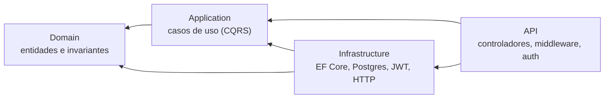
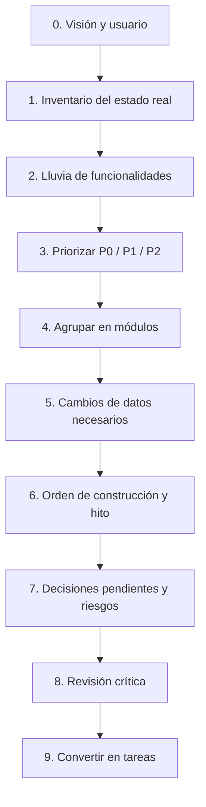
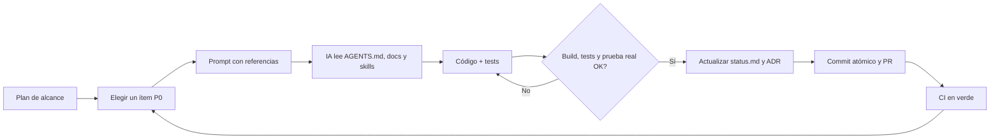

# Guía: arrancar y configurar un proyecto para trabajar con IA

Receta genérica, independiente del stack, para dejar un repo listo para que un
agente de IA (Claude Code, Antigravity, Cursor, etc.) trabaje con poca
supervisión. Está sacada de cómo se armó Alexara, pero sirve para cualquier
proyecto.

> **Idea central:** la IA no recuerda nada entre sesiones. Lo que no está escrito
> en el repo, no existe. La documentación **es** el contexto del agente.

## Cómo leer esta guía

| Si querés... | Andá a |
| :--- | :--- |
| Dejar un repo listo desde cero | Parte I y Parte II |
| Entender monorepo, Clean Architecture y patrones | §4 |
| Armar el plan de alcance del MVP | Parte III |
| Saber cómo pedirle trabajo a la IA | Parte IV (prompts en §16) |
| Copiar plantillas | Apéndice (§18) |
| Entender un término | Glosario (§21) |

## Índice

**Parte I — Primeros pasos**

1. [Estructura base](#1-estructura-base)
2. [Orden para arrancar](#2-orden-para-arrancar)

**Parte II — Cómo se arma el repo**

3. [`AGENTS.md` y `CLAUDE.md`](#3-agentsmd-y-claudemd)
4. [Arquitectura del repo: monorepo, Clean Architecture y patrones](#4-arquitectura-del-repo-monorepo-clean-architecture-y-patrones)
5. [Documentos de arquitectura](#5-documentos-de-arquitectura)
6. [Skills](#6-skills)
7. [Migraciones y decisiones](#7-migraciones-y-decisiones)
8. [`status.md`: la memoria del proyecto](#8-statusmd-la-memoria-del-proyecto)
9. [Entorno, Git y CI](#9-entorno-git-y-ci)

**Parte III — Planear el MVP y las tareas**

10. [Plan de alcance (`docs/alcance.md`)](#10-plan-de-alcance-docsalcancemd)
11. [Planear el MVP y el alcance con la IA, paso a paso](#11-planear-el-mvp-y-el-alcance-con-la-ia-paso-a-paso)
12. [Del alcance a las tareas: cómo pedirle trabajo a la IA](#12-del-alcance-a-las-tareas-cómo-pedirle-trabajo-a-la-ia)

**Parte IV — Trabajar con la IA**

13. [El ciclo de trabajo, paso a paso](#13-el-ciclo-de-trabajo-paso-a-paso)
14. [El flujo completo de un vistazo](#14-el-flujo-completo-de-un-vistazo)
15. [Quién hace qué: humano e IA](#15-quién-hace-qué-humano-e-ia)
16. [Cómo pedirle cosas a la IA (prompts)](#16-cómo-pedirle-cosas-a-la-ia-prompts)
17. [Cuando la IA se equivoca (troubleshooting)](#17-cuando-la-ia-se-equivoca-troubleshooting)

**Apéndices**

18. [Plantillas copiables](#18-plantillas-copiables)
19. [Checklist de arranque](#19-checklist-de-arranque)
20. [Errores comunes](#20-errores-comunes)
21. [Glosario](#21-glosario)

---

# Parte I — Primeros pasos

## 1. Estructura base

```text
repo/
├── AGENTS.md              # Contrato de trabajo (lo lee el agente en cada sesión)
├── CLAUDE.md              # Una línea: @AGENTS.md
├── README.md              # Qué es el proyecto, en breve
├── CONTRIBUTING.md        # Cómo levantar el entorno
├── skills-lock.json       # Skills instaladas, con versión fijada
├── .claude/skills/        # Skills: guías de dominio cargadas a demanda
├── .github/workflows/     # CI: lo que la IA no puede "creer", se verifica
└── docs/
    ├── README.md          # Índice y orden de lectura para alguien nuevo
    ├── alcance.md         # Plan de alcance: qué se construye y en qué orden
    ├── status.md          # Qué está hecho, qué falta, cómo se verificó
    ├── architecture.md    # Cómo encaja el sistema
    ├── <area>-architecture.md   # Reglas por área (api, frontend, etc.) + receta
    ├── migraciones.md     # Cómo cambiar el esquema de la base (si hay base)
    ├── git-workflow.md    # Ramas, commits, PRs
    └── decisions/         # ADRs: por qué las cosas son como son
```

Regla de oro: **cada archivo responde una sola pregunta.** Si responde dos, se
parte.

---

## 2. Orden para arrancar

1. Crear el repo y el entorno reproducible (ver §9).
2. Escribir `AGENTS.md` con lo mínimo (§3) y `CLAUDE.md` con `@AGENTS.md`.
3. Escribir el plan de alcance (§10) **antes** de pedirle código a la IA.
4. Escribir `architecture.md` y una receta de "feature nueva" por área (§5).
5. Instalar las skills del stack (§6).
6. Configurar CI y flujo de Git (§9).
7. Crear `status.md` vacío con la tabla de estados (§8).
8. Recién entonces, tareas chicas a la IA, una por sesión (§13).

---

# Parte II — Cómo se arma el repo

## 3. `AGENTS.md` y `CLAUDE.md`

`AGENTS.md` es el estándar que leen la mayoría de las herramientas. Claude Code
lee `CLAUDE.md`; para no mantener dos copias, ese archivo contiene solo:

```markdown
@AGENTS.md
```

### Plantilla de `AGENTS.md`

```markdown
# <Proyecto> — modo de trabajar

<Qué es, en 2 líneas.>

Documentos relacionados:
- docs/architecture.md — cómo encaja el sistema.
- docs/<area>-architecture.md — leelo antes de tocar <carpeta>.
- docs/status.md — qué está hecho y qué falta.

## Stack
| Área | Tecnología |
| :--- | :--- |
| ... | ... |

## Comandos
<Comandos copiables: entorno, build, test, lint. Con el criterio de éxito,
p. ej. "build en 0 warnings".>

## Estructura
<Árbol del repo, una línea por carpeta.>

## Reglas que no se negocian
<Cada una: qué hacer + qué se rompe si no se hace.>

## Convenciones de código
<Por lenguaje. Solo lo que el linter no cubre.>

## Flujo de trabajo
<Ramas, commits, verificación previa al PR, actualizar status.md, ADRs.>

## Para agentes
- Tests obligatorios según lo que se toque.
- No afirmar que algo funciona sin verificarlo (correrlo, no solo compilar).
- No inventar el estado del proyecto: verificar contra el código.
- Al terminar, actualizar docs/status.md.
```

### Cómo escribir "reglas que no se negocian"

Solo entran reglas que, **al romperlas, fallan en silencio**: no hay error, no
hay log, y el síntoma no apunta a la causa (credenciales de admin en vez de un
usuario limitado, editar una migración ya aplicada, guardar permisos en un token
que no se renueva). Formato: **regla + consecuencia**. Una regla sin
consecuencia explícita el agente la "simplifica" y la rompe.

Las preferencias de estilo no van acá: se delegan al linter.

### Comentarios en el código

Pedí que los comentarios expliquen **por qué**, nunca qué: la razón, la
alternativa descartada y qué se rompe si alguien lo simplifica. Sin esto, la IA
"limpia" código que estaba así a propósito.

### Tips

- Máximo ~300 líneas: se carga en **cada** sesión y ocupa contexto. Lo extenso
  va en `docs/` y se enlaza.
- Imperativo y concreto ("todo endpoint de X lleva Y"), no vago ("cuidá la
  seguridad").
- Si el framework cambia rápido, indicá dónde leer la documentación de la
  versión instalada (por ejemplo dentro de `node_modules/`).

---

## 4. Arquitectura del repo: monorepo, Clean Architecture y patrones

Esta sección explica **qué decisiones de estructura toma Alexara y por qué ayudan
a trabajar con IA**. No es obligatorio copiarlas tal cual: al final (§4.9) hay una
guía para decidir cuáles te convienen a vos.

> **Principio de fondo:** a una IA le rinde la arquitectura que es **predecible,
> con fronteras claras y verificable por máquina**. Cada patrón de abajo se
> justifica porque reduce lo que el agente tiene que adivinar.

### 4.1 Monorepo: un solo repositorio para todo

Un **monorepo** guarda varias aplicaciones y paquetes en el mismo repositorio
Git, en vez de un repo por aplicación (multirepo). Alexara tiene una API en .NET,
tres frontends en Next.js, paquetes compartidos y la base de datos, todo junto.

```text
alexara/
├── apps/
│   ├── api/          # Backend .NET (Clean Architecture + CQRS)
│   ├── store/        # Storefront público
│   ├── dashboard/    # Panel del comerciante
│   └── admin/        # Panel de la plataforma
├── packages/
│   ├── api-client/   # Cliente tipado de la API (lo usan los 3 frontends)
│   ├── types/        # Tipos de dominio compartidos
│   ├── ui/           # Componentes y sistema de diseño
│   └── utils/        # Utilidades comunes
├── db/               # Migraciones, roles y tests de aislamiento
├── docs/             # Documentación y ADRs
└── scripts/db.sh     # Único punto de entrada a la base
```

**Herramientas:** `pnpm workspaces` enlaza los paquetes entre sí
(`pnpm-workspace.yaml`) y **Turborepo** orquesta las tareas (`turbo run build`,
`lint`, `dev`) con caché y respetando dependencias (`dependsOn: ["^build"]`:
primero se construyen los paquetes de los que depende una app).

#### Ventajas generales

| Ventaja | Qué significa |
| :--- | :--- |
| **Cambios atómicos** | Un cambio de contrato (API + tipos + pantalla) va en **un solo commit y un solo PR**. No hay versiones desincronizadas entre repos. |
| **Código compartido sin publicar** | `@alexara/types` o `@alexara/ui` se usan directo, sin publicar paquetes ni versionarlos. |
| **Una sola configuración** | Un CI, un lint, un flujo de Git, una convención de commits. |
| **Refactors globales** | Renombrar un tipo o un endpoint se hace en todo el repo a la vez. |
| **Visibilidad** | Todo el equipo ve todo el sistema; no hay "cajas negras" en otro repo. |

#### Por qué un monorepo es especialmente bueno para trabajar con IA

1. **El agente ve el sistema completo.** Con un repo por servicio, la IA solo ve
   una parte y tiene que adivinar cómo es el otro lado. En un monorepo puede leer
   el controlador de la API **y** la pantalla que lo consume en la misma sesión.
2. **Un cambio de contrato se hace de punta a punta.** "Agregá el campo `X` al
   producto" toca la migración, la entidad, el DTO, el tipo de `@alexara/types` y
   el formulario. La IA lo hace consistente en un solo pedido y un solo PR.
3. **Un solo `AGENTS.md` y un solo juego de skills** gobiernan todo. Las reglas no
   se duplican ni se desactualizan entre repos.
4. **Los tipos compartidos eliminan una clase entera de errores.** El tipo vive en
   un solo lugar (`packages/types`), así que la IA no inventa una versión propia
   del modelo en cada frontend. Por eso la regla "prohibido duplicar entidades".
5. **Una receta y una verificación únicas.** `pnpm run lint`, `pnpm run build` y
   `dotnet test` validan todo; la IA corre los mismos comandos sin importar qué
   parte tocó.
6. **Documentación junto al código.** La IA encuentra `docs/` y `AGENTS.md` al
   lado de lo que está editando.
7. **Búsqueda y refactor más certeros.** Buscar "¿quién usa esto?" cubre el repo
   entero y evita romper un consumidor que estaba en otro lado.

#### Costos y cómo mitigarlos

| Costo | Mitigación |
| :--- | :--- |
| El repo es grande y la IA puede leer de más | `AGENTS.md` con la estructura y "leé X antes de tocar Y"; docs por área. |
| Una app importa algo que no debería de otra | Reglas de frontera: las apps **no se importan entre sí**; solo usan `packages/*`. Hacerlo cumplir con lint. |
| Builds lentos | Turborepo cachea y solo reconstruye lo afectado; `--filter=<app>` para una sola app. |
| El CI corre todo siempre | Jobs separados por área (API, frontends, RLS) y caché de dependencias. |
| Acceso y permisos más difusos | `CODEOWNERS` por carpeta si el equipo crece. |

> **Regla para tu repo:** si dos piezas cambian juntas con frecuencia (API y su
> frontend, un esquema y sus tipos), conviene que vivan en el mismo repositorio.

### 4.2 Clean Architecture (arquitectura limpia)

Organiza el backend en **capas concéntricas** donde las dependencias apuntan
**siempre hacia adentro**: lo más importante (reglas de negocio) no depende de lo
más cambiante (base de datos, framework web, servicios externos).



| Capa | Qué contiene | Puede depender de |
| :--- | :--- | :--- |
| **Domain** | Entidades, invariantes, value objects. Reglas del negocio puras. | Nada |
| **Application** | Casos de uso (comandos y queries), validadores, DTOs e **interfaces** de lo que necesita de afuera. | Domain |
| **Infrastructure** | Las **implementaciones**: EF Core, repositorios, JWT, clientes HTTP, email. | Application, Domain |
| **API** | Controladores, middleware, autorización, composición de dependencias. | Application, Infrastructure |

**Regla de dependencia:** el Dominio no conoce a nadie. Application no sabe que
existe EF Core ni ASP.NET. Cuando un caso de uso necesita algo externo (hashear
una contraseña, emitir un token), **declara una interfaz** en Application y la
implementación vive en Infrastructure
(`IPasswordHasher`, `ITokenService`, `IStorefrontCacheInvalidator`).

#### Estructura real de la API de Alexara

```text
apps/api/
├── src/
│   ├── alexara.Domain/          # entidades, invariantes
│   ├── alexara.Application/     # Features/<Feature>/Commands, Queries, DTOs
│   ├── alexara.Infrastructure/  # EF Core, repositorios, servicios
│   └── alexara.API/             # controladores, middleware
└── tests/
    ├── alexara.Domain.Tests/        # invariantes y métodos de fábrica
    ├── alexara.Application.Tests/   # validadores y handlers (con mocks)
    └── alexara.Integration.Tests/   # consultas y escrituras bajo RLS
```

Hay **un proyecto de tests por capa**: la regla de qué test escribir según lo que
se toca (en `AGENTS.md`) es directa y verificable.

#### Por qué ayuda a trabajar con IA

| Propiedad | Beneficio con IA |
| :--- | :--- |
| **Cada cosa tiene un lugar único** | La IA no decide dónde poner el código: la capa lo dice. Menos decisiones = menos errores. |
| **Receta repetible** | Toda feature se construye con los mismos pasos (entidad → comando → handler → controlador → tests). La IA los sigue como una plantilla. |
| **Fronteras comprobables** | Si Domain referencia EF Core, no compila o falla una regla. El error aparece al instante, no en producción. |
| **Tests por capa** | Dominio y Application se testean sin base de datos ni servidor: la IA los corre rápido y obtiene feedback inmediato. |
| **Cambios localizados** | Cambiar el hash de contraseñas toca solo Infrastructure; la IA no tiene que revisar todo el sistema. |
| **Menos "código espagueti"** | Los handlers de un solo caso de uso son chicos y entran enteros en el contexto de la IA. |

#### El costo (y cuándo no vale la pena)

Clean Architecture agrega archivos, interfaces y cierta ceremonia. En un script,
un prototipo o un CRUD chico es **sobreingeniería**. Vale la pena cuando hay
lógica de negocio real, varios desarrolladores (humanos o IA) y un horizonte
largo. En Alexara se justifica porque el aislamiento entre tiendas depende de que
todas las escrituras pasen por el mismo lugar.

### 4.3 CQRS con MediatR: un caso de uso, un archivo

**CQRS** separa las operaciones que **modifican** estado (comandos) de las que
solo **leen** (queries). **MediatR** implementa el patrón *Mediator*: el
controlador envía un mensaje y el handler correspondiente lo resuelve, sin que
se conozcan entre sí.

```text
Features/
└── Auth/
    ├── Commands/
    │   ├── AuthCommands.cs          ← los records de comando
    │   ├── AuthValidators.cs        ← FluentValidation
    │   ├── LoginCommandHandler.cs   ← un handler por archivo
    │   └── RegisterCommandHandler.cs
    └── DTOs/
```

- **Un handler por archivo**, junto a su comando. Entra completo en el contexto de
  la IA y es fácil de revisar.
- **`ValidationBehavior`** corre los validadores antes de cada handler: el handler
  nunca recibe input sin validar, así que la IA no tiene que acordarse de validar.
- **El controlador no tiene lógica:** traduce HTTP a comando y `Result` a código
  de estado.
- **`Result` para fallos esperados** (slug tomado, credenciales inválidas) y
  **excepciones para bugs e invariantes violadas**. La distinción define el código
  HTTP y qué aparece en los logs.

### 4.4 Entidades de dominio ricas, no anémicas

En lugar de clases con propiedades públicas editables desde cualquier lado, las
entidades **protegen sus reglas**:

- Setters **privados** y **métodos de fábrica** estáticos (`Tenant.Create(...)`).
- Las invariantes se validan al crear o modificar; si se violan, lanzan una
  excepción de dominio.
- Las entidades de tienda **heredan de `TenantEntity`**, y con eso quedan
  filtradas y estampadas por tienda automáticamente.

**Con IA:** una entidad que no permite estados inválidos es una barrera contra los
errores del agente. Si la IA intenta crear un objeto incoherente, el dominio lo
rechaza en el momento, y los tests de dominio lo cubren.

### 4.5 Eventos de dominio y Outbox

Los efectos secundarios (mandar un email, descontar stock, auditar) **no se
escriben a mano dentro del handler principal**. Se levantan como eventos
([ADR-0011](decisions/0011-eventos-de-dominio-y-outbox.md)):

| Tipo | Cuándo | Garantía |
| :--- | :--- | :--- |
| **Evento de dominio** | Reacción interna, en memoria | Todo o nada junto con el cambio que lo originó. |
| **Evento de integración (Outbox)** | Efecto que sale del sistema (email, webhook) | Se guarda en una tabla `outbox_messages` en la misma transacción; un worker lo entrega después. Si el proveedor externo falla, la operación de negocio no se pierde. |

**Con IA:** el handler queda enfocado en una sola cosa; el agente no mezcla
responsabilidades ni deja caer una operación por un servicio externo caído.

### 4.6 Aislamiento multi-tenant en la base: RLS

Alexara es un sistema donde **muchos clientes (tiendas) comparten la misma base**.
El aislamiento no depende de que cada consulta recuerde filtrar por tienda:

- **Row Level Security (RLS)** en Postgres filtra las filas por tienda a nivel de
  la base ([ADR-0001](decisions/0001-rls-como-barrera-real.md)).
- La API se conecta con un rol **sin privilegios de dueño**
  ([ADR-0008](decisions/0008-roles-de-postgres-dedicados.md)).
- Claves primarias compuestas `(tenant_id, id)`
  ([ADR-0003](decisions/0003-claves-primarias-compuestas.md)).
- La tienda viaja en la URL, no en el JWT
  ([ADR-0004](decisions/0004-tenant-en-la-url-no-en-el-jwt.md)).
- Un callback de migración **falla el deploy** si alguna tabla con `tenant_id`
  quedó sin política.

**Con IA:** esta es la lección más importante del repo. Si el agente olvida un
filtro `WHERE tenant_id = ...` en C#, **los datos igual no se filtran entre
clientes**, porque la garantía está en la capa más baja. *Las garantías críticas
no deben depender de que la IA (ni una persona) se acuerde.*

### 4.7 Arquitectura de los frontends: features y Thin Shell

Cada app Next.js se organiza por **feature**, no por tipo de archivo:

```text
app/        → solo routing (páginas y layouts delgados)
features/   → dominio, una carpeta por feature
lib/        → infraestructura (HTTP, caché, entorno)
```

```text
features/<feature>/
├── index.ts         # única superficie pública
├── queries.ts       # lecturas (Server Components)
├── actions.ts       # mutaciones (Server Actions)
├── schemas.ts       # validaciones Zod
├── types.ts
└── components/      # Sections (async, con Skeleton), Views (puras), Islas de cliente
```

- **Thin Shell:** `page.tsx` y `layout.tsx` son armazones de 20 a 40 líneas: solo
  metadatos, params, límites de `Suspense` y composición.
- **Una sola puerta:** desde afuera solo se importa `@/features/<feature>`; nunca
  archivos internos.
- **Cliente de API único:** toda llamada a la API pasa por `@alexara/api-client`;
  las features nunca escriben URLs a mano.
- **El navegador nunca toca la API .NET:** las peticiones salen del servidor de
  Next por la red privada, con el tenant y el token inyectados de forma segura.
- **Server Components y Server Actions** en lugar de endpoints propios para cada
  CRUD de la UI.

La pregunta que organiza todo: *"¿si borro la feature de catálogo, cuántos
directorios tengo que tocar?"* La respuesta debe ser **uno** (más su ruta).

**Con IA:** la estructura es tan regular que el agente puede crear una feature
nueva copiando el patrón. Y como cada feature es una unidad aislada, un cambio no
rompe a las demás.

### 4.8 Resumen: principio, dónde se ve y cómo ayuda

| Principio / patrón | Dónde se ve en el repo | Cómo ayuda con IA |
| :--- | :--- | :--- |
| **Monorepo** | `apps/` + `packages/` + `db/` + `docs/` | Contexto completo y cambios de punta a punta en un solo PR |
| **Clean Architecture** | `Domain` / `Application` / `Infrastructure` / `API` | Cada cosa tiene un lugar; fronteras que se verifican |
| **CQRS + Mediator** | `Features/<X>/Commands`, un handler por archivo | Casos de uso chicos y fáciles de revisar |
| **Inversión de dependencias** | Interfaces en `Application`, implementaciones en `Infrastructure` | Se cambia una tecnología sin tocar la lógica |
| **Result pattern** | `FluentResults` para fallos esperados | Errores explícitos y códigos HTTP coherentes |
| **Entidades ricas / fábricas** | `Tenant.Create(...)`, setters privados | El dominio rechaza estados inválidos |
| **Eventos + Outbox** | [ADR-0011](decisions/0011-eventos-de-dominio-y-outbox.md) | Efectos secundarios desacoplados y confiables |
| **RLS** (defensa en profundidad) | `db/migrations/R__rls.sql` + callback | La garantía de aislamiento no depende de la IA |
| **Migraciones versionadas** | Flyway + `scripts/db.sh` | Cambios de esquema reproducibles y auditables |
| **Features + Thin Shell** | `features/<x>/` y `app/` delgado | Patrón regular que la IA replica sin desviarse |
| **Cliente de API tipado** | `@alexara/api-client` | Un único contrato, sin URLs ni tipos duplicados |
| **Tipos compartidos** | `@alexara/types` | Sin desincronización silenciosa entre API y UI |
| **Tests por capa** | `Domain.Tests`, `Application.Tests`, `Integration.Tests`, `rls_test.sql` | Feedback rápido y criterio claro de "terminado" |
| **ADRs** | `docs/decisions/` | La IA entiende **por qué**, no solo qué |
| **Decisiones diferidas con disparo** | Redis y particionamiento ([ADR-0012](decisions/0012-redis-diferido.md), [ADR-0009](decisions/0009-particionamiento-diferido.md)) | Evita sobreingeniería sin olvidar el tema |

### 4.9 Cómo elegir la arquitectura para tu proyecto

No copies todo. Decidí según el tamaño y el riesgo:

| Situación | Recomendación |
| :--- | :--- |
| Prototipo o script de pocos días | Estructura simple por carpetas. Sin capas ni CQRS. |
| App con lógica de negocio mediana, un equipo chico | Capas básicas (dominio / aplicación / infraestructura) y tests por capa. |
| Producto de largo plazo, varios desarrolladores o agentes de IA | Clean Architecture + CQRS, features por carpeta, ADRs y CI estricto. |
| Datos de varios clientes en la misma base | **Aislamiento en la base** (RLS o equivalente), nunca solo en la aplicación. |
| API y frontend que cambian juntos | **Monorepo.** |
| Equipos independientes con ciclos de release distintos | Multirepo puede ser más sano. |

**Criterios para decidir:**

1. **¿Qué falla en silencio si me equivoco?** Esa parte merece una garantía
   automática (restricción de base, test de arquitectura, CI).
2. **¿Cuánto va a cambiar esto?** Lo volátil (framework, base) debe quedar en
   capas externas; lo estable (reglas de negocio) en el centro.
3. **¿Puede un recién llegado (o una IA) agregar una feature sin preguntar
   dónde va?** Si no, falta estructura o una receta.
4. **¿Puedo verificar la regla por máquina?** Preferí lint, tipos y tests antes
   que reglas solo escritas.

### 4.10 Cómo hacer que la IA respete la arquitectura

1. **Escribila como regla** en `AGENTS.md`, con su consecuencia:
   > *"Domain no referencia ningún otro proyecto. Si un handler necesita algo de
   > afuera, declará la interfaz en `Application/Common/Interfaces` y su
   > implementación en `Infrastructure`. Si no, el dominio queda atado a la
   > tecnología y los tests dejan de correr sin base de datos."*
2. **Dejá una receta** de feature nueva por área (ver §5 y §18).
3. **Hacela cumplir por máquina:** reglas de lint para imports prohibidos
   (`features/*` solo vía `index.ts`), tests de arquitectura que fallan si una
   capa referencia a otra, y CI que bloquea el merge.
4. **Pedile que lea antes de escribir:** *"Mirá cómo está hecha la feature
   `<existente>` y replicá su estructura"* es el atajo más confiable.
5. **Revisá fronteras en cada PR:** ¿algún import cruza una capa o una app? ¿Hay
   tipos duplicados? ¿Hay una URL escrita a mano?

---

## 5. Documentos de arquitectura

Responden "cómo encaja esto" y, sobre todo, **"qué regla aplico cuando agrego
algo"**.

- **`architecture.md`:** el problema central que define el diseño, topología,
  componentes, seguridad/aislamiento, despliegue. Con diagramas.
- **`<area>-architecture.md`** (uno por backend, frontend, etc.): capas y regla
  de dependencia, manejo de errores, persistencia, autorización, tests.

### La receta

Cada doc de área termina con una **receta numerada de punta a punta** ("Receta:
agregar una feature"): qué archivos crear, en qué orden, qué test escribir. Es
lo que más rinde con IA: en vez de deducir la estructura, la sigue. Con una
buena receta el código nuevo sale con la forma correcta de primera.

### Principios para decidir la arquitectura

- Preferí garantías **en la capa más baja posible** (la base, el compilador)
  antes que convenciones en la aplicación: un filtro olvidado no debería poder
  filtrar datos.
- Un solo lugar para los tipos compartidos: duplicarlos oculta cambios de
  contrato.
- Estructura por **feature**, no por tipo de archivo.
- Capas delgadas en el borde (rutas, controladores): sin lógica de negocio.

---

## 6. Skills

Una skill es una carpeta con un `SKILL.md` (frontmatter `name` y `description`)
y opcionalmente `references/` y `scripts/`. El agente ve solo nombre y
descripción y **carga el contenido cuando la tarea coincide**: mucho
conocimiento especializado sin gastar contexto en cada sesión.

```markdown
---
name: mi-skill
description: Usar cuando <situación concreta que dispara la skill>.
---
# Título
Instrucciones, checklists, ejemplos.
```

### Qué instalar

Elegí por el **stack real**, no por cantidad. Categorías útiles:

| Categoría | Ejemplos de skills |
| :--- | :--- |
| Backend | patrones del framework, optimización de consultas del ORM |
| Base de datos | diseño de tablas, buenas prácticas del motor |
| Frontend | patrones del framework, rendimiento, composición de componentes |
| Diseño | sistema de diseño, guías de UI/UX |
| Testing | ejecutar tests, testing de la app web |
| Calidad | detección de deuda típica de código generado por IA |
| Sesión | `session-guard`: evita que sesiones largas pierdan las reglas |

Se instalan con el CLI de skills (`npx skills add <owner/repo>`). Queda
registrado en `skills-lock.json` (origen, ruta y hash): se commitea para que todo
el equipo use las mismas versiones.

### Skills propias

Si una instrucción se repite en prompts (la receta de feature nueva, el checklist
de PR), conviértela en skill. Cuidado con instalar de más: cada descripción
ocupa contexto y puede disparar cuando no corresponde.

---

## 7. Migraciones y decisiones

### Migraciones de base de datos

Si hay base de datos, documentá **cómo** cambiar el esquema y automatizalo con un
script, para que el agente no improvise SQL contra la base.

Estructura recomendada (herramienta de migraciones, p. ej. Flyway):

```text
db/
├── migrations/
│   ├── V001__esquema_inicial.sql   # versionada: corre una vez
│   ├── R__permisos.sql             # repetible: permisos
│   └── afterMigrate__verificar.sql # callback: falla si algo no cumple
├── provisioning/roles.sql          # roles a nivel cluster, fuera de las migraciones
├── tests/                          # tests SQL de las garantías (aislamiento, etc.)
└── schema.generated.sql            # snapshot legible, se commitea para diffs
scripts/db.sh                       # único punto de entrada
```

Reglas genéricas:

- Cambio de esquema = **migración nueva**; una ya aplicada no se edita (la
  herramienta valida checksums y producción quedaría con otro esquema).
- Lo que se pueda derivar automáticamente (permisos, políticas de seguridad) va
  en scripts **repetibles**, no a mano en cada migración.
- Un **callback de verificación que rompe el deploy** si se incumple una
  garantía: se hace cumplir por máquina, no por memoria.
- La aplicación se conecta con un usuario **sin privilegios de dueño**.
- En producción las migraciones son un paso de despliegue aparte.
- Incluí una tabla de **problemas frecuentes** (síntoma → causa) en
  `migraciones.md`: el agente la consulta antes de diagnosticar a ciegas.

Comandos mínimos del script: `setup`, `migrate`, `new <desc>`, `validate`,
`test`, `dump`.

**Conexión con el alcance:** la tabla de cambios de esquema del plan de alcance
es el backlog. Cada fila es una migración, y se crea cuando arranca el módulo
que la necesita, no todas juntas.

### ADRs (`docs/decisions/`)

Un archivo corto por decisión difícil de revertir. El código dice qué hace, no
por qué no se hizo de otra forma.

```markdown
# ADR-NNNN — Título en una línea

- **Estado:** Propuesta | Aceptada | Reemplazada por ADR-XXXX
- **Fecha:** AAAA-MM-DD

## Contexto
El problema, las restricciones, qué pasaba si no se decidía.

## Decisión
Qué se hizo, en una o dos oraciones.

## Alternativas descartadas
Cada una con el motivo concreto. (La sección que más vale.)

## Consecuencias
Lo bueno, lo que se paga, qué se rompe si se revierte.
```

Escribí una cuando la decisión es difícil de revertir, descartaste una
alternativa razonable, o alguien podría "arreglar" el código rompiendo algo. Las
decisiones **diferidas** ("lo hacemos más adelante") llevan *criterios de
disparo*: cuándo reabrirlas.

---

## 8. `status.md`: la memoria del proyecto

Qué está hecho, qué falta y **cómo se verificó** ("compila" ≠ "funciona").

1. Tabla resumen con estados ✅ / 🟡 / ⬜.
2. Por área: qué hay + **"Cómo se verificó"** (petición real al endpoint, N tests
   pasando, comparación esquema vs. modelo).
3. Lo pendiente, incluyendo **lo que no se pudo verificar**.

Se actualiza al cerrar cada funcionalidad. Si no coincide con el código, se
corrige: un estado viejo es peor que ninguno. El agente no lo toma como verdad:
lo contrasta con el código.

---

## 9. Entorno, Git y CI

- **`CONTRIBUTING.md`:** pasos exactos para levantar el entorno desde cero
  (dependencias, contenedores, secretos locales, primer build). Probalos en una
  máquina limpia.
- **Secretos:** nunca en archivos versionados; placeholders en la config y
  valores reales por gestor de secretos del entorno.
- **`git-workflow.md`:** `pull` antes de ramificar, ramas cortas
  `<tipo>/<nombre>` (`feat/`, `fix/`, `docs/`, `refactor/`, `chore/`),
  Conventional Commits atómicos (`<tipo>(<scope>): <descripción>`), `pull
  --rebase` antes de pushear.
- **Verificación local antes del PR:** build sin warnings, tests, lint, tests de
  base si se tocó el esquema.
- **CI:** repite esas verificaciones en cada PR. La IA no puede decir "funciona"
  con el CI en rojo.
- **Tests obligatorios** según lo que se toque (dominio, validadores/handlers,
  integración). "Ninguna funcionalidad está terminada sin sus tests."

---

# Parte III — Planear el MVP y las tareas

## 10. Plan de alcance (`docs/alcance.md`)

Le dice al equipo **y a la IA** qué construir y qué no.

### Estructura

1. **Definición de "terminado".** Una frase con el recorrido completo del
   usuario ("un usuario puede registrarse, crear X y completar Y"). Todo se mide
   contra eso.
2. **Prioridades:**
   - **P0:** sin esto no hay MVP.
   - **P1:** entra, pero se puede simplificar.
   - **P2:** entra, se construye después de P0 y P1.
   - **Idea tentativa:** no entra; se anota para evaluar después.
3. **Punto de partida** en tabla: `Área | Estado hoy | Qué falta`. Se arma
   verificando contra el código, no confiando en notas viejas.
4. **Módulos y alcance.** Por cada módulo: contexto, ítems `P0 · Nombre.` con
   comportamiento, límites y por qué, y al final **"Ideas tentativas"** (lo que
   queda explícitamente afuera: frena el *scope creep* de la IA).
5. **Cambios de esquema/datos** en tabla: `Cambio | Tipo | Alcance | Módulo |
   Prioridad`. Es el backlog de migraciones (§7).
6. **Ideas para después del MVP.**
7. **Orden de construcción** en fases: primero los cimientos que bloquean a todo
   (almacenamiento, colas, emails, auth), después el primer flujo completo de
   punta a punta, después el resto. Cerrá con un **hito verificable** ("la beta
   arranca cuando una compra completa pasa en el sandbox").
8. **Decisiones:** tabla de *tomadas* (con enlace a ADR si afectan la
   arquitectura) y lista de *pendientes* con checkbox y **qué módulo bloquea
   cada una**.

### Pasos para armarlo

1. Escribí la frase de "terminado".
2. Inventariá el estado real (código, esquema, `status.md`).
3. Listá módulos por flujo de usuario, no por capa técnica.
4. Por cada funcionalidad: prioridad + comportamiento + qué queda afuera.
5. Deducí los cambios de base necesarios.
6. Marcá decisiones abiertas y qué bloquean; cerralas **antes** de arrancar ese
   módulo.
7. Ordená en fases con un hito verificable.
8. Cada decisión de arquitectura nueva → ADR (§7).

> **Con IA:** podés pedirle un borrador, pero pasale el código y `status.md`
> como fuente y revisá vos las decisiones de producto. La IA completa huecos con
> supuestos plausibles.

---

## 11. Planear el MVP y el alcance con la IA, paso a paso

El plan de alcance (§10) es el documento más importante: es lo que evita que la
IA construya cosas que nadie pidió. Esta sección es el **proceso** para armarlo
conversando con la IA, con el prompt de cada paso. Regla general: **vos decidís
producto, la IA ordena, investiga y redacta.**

### Visión general del proceso



### Paso 0 — Visión y usuario (lo escribís vos)

Antes de abrir la IA, respondé en 5 líneas:

1. **¿Quién es el usuario?** (un comerciante, un médico, un docente…)
2. **¿Qué problema le resolvés?**
3. **¿Cómo sabés que el MVP está "terminado"?** Una frase con el recorrido
   completo de punta a punta.
4. **¿Qué NO es este producto?** (límites explícitos)
5. **Restricciones:** plazo, equipo, presupuesto, tecnologías obligatorias,
   regulaciones.

> Si no podés escribir la frase de "terminado", el MVP todavía no está definido y
> la IA va a llenar el vacío con suposiciones.

### Paso 1 — Inventario del estado real

Si el repo ya tiene código, la IA lo recorre y arma la tabla `Área | Estado hoy
| Qué falta`. Siempre contra el código, nunca contra notas viejas.

```text
Leé el código de <carpetas>, el esquema de la base y docs/status.md.
Armame una tabla "Área | Estado hoy | Qué falta" con lo que REALMENTE existe.
Marcá las inconsistencias entre la documentación y el código.
No inventes: si algo no lo pudiste verificar, escribilo como "no verificado".
```

Si el repo está vacío, este paso se reemplaza por "qué existe afuera" (sistemas a
integrar, cuentas de terceros, diseño previo).

### Paso 2 — Lluvia de funcionalidades

Acá sí conviene que la IA proponga: es buena para completar lo que olvidaste.

```text
Producto: <visión del paso 0>. Usuario: <quién>.
Listame todas las funcionalidades que un <tipo de producto> necesita para que el
usuario complete <frase de terminado>. Agrupalas por flujo de usuario, no por
tecnología. Incluí también lo que se suele olvidar: emails transaccionales,
recuperar contraseña, permisos, errores, estados vacíos, administración,
facturación, legales.
```

Después **filtrás vos**: la IA va a sugerir de más.

### Paso 3 — Priorizar P0 / P1 / P2

Criterio para cada funcionalidad, en este orden:

| Pregunta | Si la respuesta es "sí" |
| :--- | :--- |
| ¿Sin esto el usuario no puede completar el recorrido de "terminado"? | **P0** |
| ¿Mejora mucho la experiencia pero hay una versión simple? | **P1** |
| ¿Se puede construir después de que lo básico funcione? | **P2** |
| ¿Es bueno pero no necesario para validar la idea? | **Idea tentativa** (afuera) |

```text
Tomá esta lista de funcionalidades: <lista>.
Clasificalas P0/P1/P2/Idea tentativa según este criterio: <tabla de arriba>.
Para cada P0, justificá en una línea por qué sin eso no hay MVP.
Marcá cuáles P0 podrían simplificarse sin romper el recorrido.
```

**Prueba de cordura:** si más de la mitad quedó P0, no priorizaste. Un MVP se
define más por lo que deja afuera que por lo que incluye.

### Paso 4 — Agrupar en módulos y detallar

Un módulo = un conjunto de funcionalidades que se construyen y se prueban
juntas. Por cada uno, la IA redacta el detalle con la plantilla de §18:

```text
Redactá el módulo "<nombre>" del alcance con esta plantilla: <plantilla de módulo>.
Para cada ítem incluí: comportamiento esperado, límites numéricos (máximos,
vencimientos), casos de seguridad y qué NO incluye.
Preguntame antes de asumir cualquier regla de negocio.
```

Insistí en las **reglas de negocio con números** (límites, plazos, topes): son lo
que la IA inventa con más soltura y lo que más cuesta corregir después.

### Paso 5 — Cambios de datos necesarios

Con los módulos definidos, deducí qué tablas o campos faltan.

```text
Con los módulos del alcance y el esquema actual (<ruta>), listame los cambios de
base necesarios en una tabla: Cambio | Tipo (nueva/ajuste/datos) | Alcance
(global o por cliente) | Módulo | Prioridad.
Marcá las tablas que no pueden llevar aislamiento por cliente y por qué.
```

Esa tabla es el backlog de migraciones (§7): cada fila será una migración.

### Paso 6 — Orden de construcción y hito

Reglas para ordenar las fases:

1. **Primero lo que bloquea a todo:** almacenamiento de archivos, colas/workers,
   emails, autenticación.
2. **Después el recorrido de punta a punta más simple** ("camino feliz"): un
   usuario completa el flujo principal aunque sea con poco.
3. **Después ampliás** módulos P0 restantes y luego P1.
4. Lo que tenga **riesgo técnico alto** (pagos, integraciones externas) se
   prueba temprano, no al final.
5. Dos módulos pueden ir en paralelo si no dependen entre sí (uno de API y otro
   de frontend, por ejemplo).

```text
Ordená los módulos en fases de construcción según estas reglas: <reglas>.
Indicá para cada fase: qué desbloquea, qué depende de qué, y qué se puede hacer
en paralelo. Cerrá con un hito verificable que diga cuándo la primera versión
está lista para usuarios reales.
```

### Paso 7 — Decisiones pendientes y riesgos

Todo lo que no sabés va acá, **con el módulo que bloquea**:

```text
Del alcance, listame las decisiones abiertas que bloquean la construcción.
Para cada una: opciones, ventajas y desventajas, tu recomendación y qué módulo
bloquea. No decidas por mí; yo elijo.
```

- Las decisiones **tomadas** pasan a la tabla de decisiones (con ADR si afectan
  la arquitectura, §7).
- Las **pendientes** llevan checkbox y se cierran **antes** de empezar el
  módulo que bloquean.

### Paso 8 — Revisión crítica

Pedile a la IA que ataque el plan antes de construir:

```text
Actuá como un revisor escéptico. Leé docs/alcance.md y decime:
1. Qué funcionalidades P0 son en realidad P1.
2. Qué falta para que el recorrido de "terminado" funcione de verdad.
3. Dependencias ocultas entre módulos.
4. Riesgos de seguridad, legales o de datos.
5. Qué ítems están definidos de forma ambigua y pueden interpretarse de dos formas.
```

Corregí el documento con lo que tenga sentido. **Un error en el alcance cuesta
10 veces más que uno en el código.**

### Paso 9 — Convertir en tareas

Ver §12.

### Ejemplo reducido (proyecto ficticio: app de turnos para consultorios)

```markdown
# Alcance del MVP — Turnos

El MVP está terminado cuando un profesional puede registrarse, configurar su
agenda y recibir un turno reservado y confirmado por email por un paciente.

- **P0:** nada más importante que este recorrido.
- **P1:** entra, simplificable.
- **Idea tentativa:** no entra.

## Módulos

### 1. Cuentas — P0
- **P0 · Registro y login con email.** Verificación por token de 24 h.
- **P0 · Recuperar contraseña.** Token de 1 h; la respuesta es idéntica exista o no el email.
- **Ideas tentativas:** login con Google, 2FA.

### 2. Agenda — P0
- **P0 · Horarios semanales** por día, con bloques de 15 min a 2 h.
- **P0 · Bloqueos puntuales** (vacaciones, feriados).
- **P1 · Varios profesionales por consultorio.**
- **Ideas tentativas:** sincronizar con Google Calendar.

### 3. Reservas — P0
- **P0 · Reservar sin cuenta,** con email y teléfono.
- **P0 · Sin turnos superpuestos:** lo garantiza la base, no la aplicación.
- **P0 · Cancelar hasta 24 h antes.**
- **Ideas tentativas:** pago de seña, lista de espera.

## Orden de construcción
1. Cuentas y emails. 2. Agenda. 3. Reservas (**hito:** una reserva real llega por email).
4. P1.

## Decisiones pendientes
- [ ] Proveedor de email. Bloquea módulos 1 y 3.
- [ ] Zona horaria por consultorio o fija. Bloquea módulo 2.
```

---

## 12. Del alcance a las tareas: cómo pedirle trabajo a la IA

El alcance dice **qué**. Una tarea dice **qué hacer hoy, con qué límites y cómo
saber que terminó**. Las tareas se arman a partir de ítems del alcance, nunca de
ideas sueltas.

### 12.1 Cómo cortar una tarea

Una buena tarea cumple todo esto:

- **Una sola cosa:** un ítem P0 (o una parte de uno) del alcance.
- **Cabe en una sesión:** si la IA necesita tocar más de ~10 archivos o varias
  capas a la vez, partila (primero API, después UI).
- **Se puede verificar:** tiene un resultado observable (un endpoint que
  responde, una pantalla que funciona, un test que pasa).
- **Tiene límites:** dice qué entra y qué no.

Ejemplo de corte: el ítem "ABM de categorías" se divide en:

1. Migración + entidad + tests de dominio.
2. Comandos/queries + validadores + tests.
3. Endpoints + prueba real con `curl`.
4. Pantalla de listado.
5. Pantalla de alta y edición.

### 12.2 Plantilla de tarea (copiable)

```markdown
## Tarea: <título corto>

**Origen:** <módulo y ítem del alcance>
**Depende de:** <tareas previas o "nada">

### Objetivo
<Qué tiene que poder hacer el usuario o el sistema al terminar.>

### Incluye
- ...

### No incluye
- ...

### Reglas a respetar
<Referencias a AGENTS.md y docs: receta, reglas de seguridad, convenciones.>

### Listo cuando (criterio de aceptación)
- [ ] Build sin warnings
- [ ] Tests nuevos pasando (dominio / aplicación / integración)
- [ ] Prueba real: <comando o pantalla y resultado esperado>
- [ ] Migración y snapshot commiteados (si aplica)
- [ ] `docs/status.md` actualizado
```

### 12.3 Definition of Ready y Definition of Done

**Lista para empezar (Ready):**

- [ ] Está en el alcance y tiene prioridad.
- [ ] No depende de una decisión pendiente.
- [ ] Las reglas de negocio tienen números concretos.
- [ ] Sabés cómo la vas a verificar.

**Terminada (Done):**

- [ ] Cumple el criterio de aceptación con **evidencia**, no con "debería".
- [ ] Los tests nuevos fallan si se rompe el comportamiento.
- [ ] La documentación afectada está actualizada.
- [ ] Revisaste el diff completo (la IA no es la última revisión).
- [ ] El CI está en verde.

### 12.4 El prompt maestro

Combina todo en un único pedido reutilizable:

```text
Contexto: leé AGENTS.md y docs/<area>-architecture.md.
Tarea: <objetivo en una oración>, ítem <N> del módulo <M> de docs/alcance.md.

Incluye: <lista>.
No incluye: <lista>. No toques <archivos o áreas fuera de alcance>.

Proceso:
1. Leé el código existente y buscá si ya hay algo similar. Resumime lo que encontraste.
2. Proponé un plan con los archivos que vas a crear o modificar. Esperá mi OK.
3. Implementá siguiendo la receta, con tests.
4. Verificá de verdad: <build>, <tests> y <prueba real>. Mostrame la salida.
5. Actualizá docs/status.md con lo hecho y lo que no pudiste verificar.

Si algo del requerimiento es ambiguo, preguntame antes de asumir.
```

**Por qué funciona:** obliga a investigar antes de escribir (evita duplicados),
da un punto de control (el plan) antes de gastar tiempo en código incorrecto, y
exige evidencia al final.

### 12.5 Cómo secuenciar varias tareas

1. Seguí el **orden de construcción** del alcance.
2. Resolvé primero las tareas que otras necesitan (migración antes que
   endpoint, endpoint antes que pantalla).
3. Una tarea = una rama = un PR chico.
4. **Sesión nueva por tarea.** Dejale a la IA el contexto necesario en los
   documentos, no en la conversación anterior.
5. Al cerrar cada módulo, corré el recorrido completo a mano: los bugs de
   integración aparecen entre tareas, no dentro de ellas.

### 12.6 Cuando el plan cambia

El alcance cambia; lo importante es que cambie **por escrito**:

1. Actualizá `docs/alcance.md` (mové el ítem de prioridad o a "ideas
   tentativas").
2. Si afecta la arquitectura, escribí o reemplazá un ADR.
3. Reflejalo en `docs/status.md`.
4. Recién entonces pedile el cambio a la IA.

Si el cambio solo existe en la conversación, la próxima sesión lo va a ignorar.

### 12.7 Pedidos que conviene evitar

| Pedido | Problema | Mejor |
| :--- | :--- | :--- |
| "Armame todo el MVP" | Imposible de revisar, deriva segura. | Una tarea por vez, siguiendo el orden del alcance. |
| "Hacelo como te parezca" | La IA decide producto por vos. | Dar las reglas de negocio con números. |
| "Seguí con lo que estabas" | Sin contexto, repite o contradice. | Sesión nueva con la tarea completa y referencias. |
| "Arreglá todos los warnings" | Cambios masivos sin relación con la tarea. | Un tipo de warning por tarea, con tests. |
| "Agregá también X ya que estás" | Scope creep con cambios sin revisar. | Anotá X en el alcance y pedilo como tarea aparte. |

---

# Parte IV — Trabajar con la IA

## 13. El ciclo de trabajo, paso a paso

1. Elegí **un ítem** del alcance (un P0 de un módulo, no el módulo entero).
2. Prompt corto con referencias:
   > "Implementá <ítem> del módulo N de `docs/alcance.md`. Seguí la receta de
   > `docs/<area>-architecture.md`. Creá la migración si hace falta."
3. El agente carga solo `AGENTS.md`, el doc relevante y las skills que
   coincidan.
4. Exigí **verificación real**: build, tests y una prueba del comportamiento
   (por ejemplo `curl`). No aceptes "debería funcionar".
5. Al terminar: actualizar `status.md` y escribir ADR si hubo decisión de
   arquitectura.
6. Commit atómico, PR chico.
7. **Sesión nueva** para la siguiente tarea (contexto limpio).

---

## 14. El flujo completo de un vistazo



Cada vuelta del ciclo es una tarea chica y una sesión nueva. El plan de alcance
alimenta el ciclo; `status.md` y los ADR lo realimentan.

---

## 15. Quién hace qué: humano e IA

La IA ejecuta rápido, pero no tiene criterio de producto ni responsabilidad
sobre el resultado. El reparto que mejor funciona:

| Etapa | Humano | IA |
| :--- | :--- | :--- |
| Definir "terminado" y prioridades | **Decide** | Sugiere borradores |
| Inventario del estado actual | Revisa | **Lo arma** leyendo el código |
| Decisiones de arquitectura | **Decide** y firma el ADR | Propone alternativas y redacta el ADR |
| Escribir código y tests | Revisa el diff | **Implementa** siguiendo la receta |
| Verificación | Exige evidencia | Corre build, tests y pruebas reales |
| Migraciones | Revisa el SQL | Escribe y aplica en local |
| Seguridad y datos sensibles | **Responsable** | Avisa riesgos que detecta |
| Deploy a producción | **Ejecuta o autoriza** | Prepara y documenta |
| Actualizar docs | Chequea que sea cierto | **Actualiza** `status.md` y docs |

Regla práctica: **la IA nunca es la última revisión** de algo que toque
seguridad, dinero o datos de usuarios.

---

## 16. Cómo pedirle cosas a la IA (prompts)

Un buen prompt cita el documento fuente, acota el alcance y define el criterio
de "listo". La IA ya tiene las reglas en `AGENTS.md`: no las repitas, referenciálas.

### Malo vs. bueno

| Malo | Por qué falla | Bueno |
| :--- | :--- | :--- |
| "Hacé el catálogo" | Sin límites: la IA inventa alcance. | "Implementá el ítem *Categorías* (P0) del módulo 3 de `docs/alcance.md`. Solo backend. Seguí la receta de `docs/api-architecture.md`." |
| "Arreglalo, no anda" | Sin síntoma ni contexto. | "Al llamar `POST /x` con Y recibo 500. Log: `...`. Reproducí, encontrá la causa raíz, arreglá y agregá un test que falle antes del fix." |
| "Mejorá el código" | No hay criterio. | "Refactorizá `X` para separar A de B sin cambiar comportamiento. Los tests actuales deben seguir pasando." |
| "Fijate si está bien" | Revisión superficial. | "Revisá este diff contra las reglas de `AGENTS.md`. Listá violaciones por archivo y línea; no cambies nada." |

### Plantillas según el tipo de tarea

**Feature nueva**

```text
Implementá <ítem> del módulo <N> de docs/alcance.md.
Seguí la receta de docs/<area>-architecture.md.
Incluye: <qué sí>. No incluye: <qué no>.
Listo cuando: build sin warnings, tests nuevos pasando y <prueba real>.
Al terminar, actualizá docs/status.md.
```

**Bug**

```text
Síntoma: <qué pasa>. Esperado: <qué debería pasar>.
Pasos para reproducir: <...>. Evidencia: <log/captura>.
Encontrá la causa raíz (no un parche), agregá un test de regresión y explícame
qué falló y por qué.
```

**Refactor**

```text
Objetivo: <qué se quiere lograr>. Restricción: no cambia el comportamiento.
Antes de editar, listá los archivos que vas a tocar y esperame confirmación.
```

**Revisión de código (solo lectura)**

```text
Revisá <rama o diff> contra AGENTS.md y docs/<area>-architecture.md.
Reportá violaciones, riesgos de seguridad y tests faltantes. No modifiques archivos.
```

**Investigación / planificación**

```text
Antes de escribir código, leé <docs/código> y proponeme un plan con alternativas,
ventajas y riesgos. Esperá mi aprobación.
```

### Buenas prácticas

- **Pedir un plan primero** en tareas grandes: es más barato corregir un plan
  que 20 archivos.
- **Una tarea por sesión**; si crece, partila.
- **Exigir evidencia**: "mostrame la salida del test", "mostrame la respuesta del
  endpoint".
- **Decir qué NO hacer**: es la mejor defensa contra el scope creep.
- **Corregir una vez, documentar siempre**: si tuviste que repetirle lo mismo
  dos veces, falta una regla en `AGENTS.md` o una skill.

---

## 17. Cuando la IA se equivoca (troubleshooting)

| Síntoma | Causa probable | Qué hacer |
| :--- | :--- | :--- |
| Ignora una regla del proyecto | Regla ausente, vaga o enterrada en un archivo largo | Reescribirla corta y concreta con su consecuencia; subirla en `AGENTS.md` |
| Inventa funciones, endpoints o parámetros | No leyó el código real o la API cambió | Pedirle que lea la fuente (código o docs de la versión instalada) y cite archivo y línea |
| Dice "listo" pero no funciona | Solo compiló, no ejecutó | Exigir evidencia de ejecución real (curl, tests, captura) |
| Duplica código o tipos que ya existen | No buscó antes de crear | Pedir "buscá si ya existe algo similar antes de escribir"; reforzar la regla de fuente única |
| Agrega funcionalidades no pedidas | Alcance difuso | Prompt con "No incluye" y ítems fuera de alcance en el plan |
| Cambia estilo o convenciones a mitad de sesión | Contexto largo, deriva | Cortar la sesión, usar `session-guard`, empezar de cero con la tarea acotada |
| Edita algo que no debía (migración vieja, config) | Falta regla explícita | Agregarla como "regla que no se negocia" y, si se puede, hacerla fallar en CI |
| Tests que pasan pero no prueban nada | Escribió el test para el código, no para el requisito | Pedir tests que **fallen antes del cambio**; revisar las aserciones |
| Docs que contradicen el código | `status.md` o guías desactualizados | Tratar la doc como sospechosa, verificar contra el código y corregirla |
| Se pierde tras muchas herramientas o mensajes | Compactación del contexto | Pedirle un resumen con decisiones y reglas, y continuar en sesión nueva |

### Cuando algo salió mal en serio

1. Frenar y **no** acumular parches encima.
2. `git diff` / `git stash` para ver y aislar lo hecho.
3. Volver al último commit bueno si hace falta (`git restore`, `git reset` en
   local, nunca sobre ramas compartidas).
4. Entender la causa raíz y anotarla: regla nueva, test nuevo o ADR.

---

# Apéndices

## 18. Plantillas copiables

### Tabla de punto de partida (alcance)

```markdown
| Área | Estado hoy | Qué falta para el MVP |
| --- | --- | --- |
| Auth | Hecho en API | Conectar al frontend |
| Catálogo | Entidades, 0 endpoints | Comandos, queries, UI |
```

### Módulo del alcance

```markdown
### N. <Módulo> — P0

<Una oración de contexto y estado actual.>

- **P0 · <Funcionalidad>.** <Comportamiento, límites y por qué.>
- **P1 · <Funcionalidad>.** <...>
- **Ideas tentativas:** <lo que queda explícitamente afuera.>
```

### Receta de "agregar una feature"

```markdown
## Receta: agregar <tipo de feature>

1. **Modelo:** crear/ajustar la entidad en `<ruta>` (reglas: ...).
2. **Base de datos:** migración nueva con `./scripts/db.sh new <desc>`.
3. **Casos de uso:** comando/query + validador en `<ruta>`, un handler por archivo.
4. **Exposición:** controlador/ruta en `<ruta>` con la autorización requerida.
5. **UI:** feature en `features/<nombre>/` (queries, actions, schemas, components).
6. **Tests:** dominio, aplicación, integración. Deben pasar antes de dar por cerrada la tarea.
7. **Verificación real:** correr y probar el endpoint o pantalla.
8. **Docs:** actualizar `docs/status.md` (y ADR si hubo decisión).
```

### Entrada de `status.md`

```markdown
### <Área>

- <Qué quedó hecho, concreto.>

**Cómo se verificó:** <comando o prueba real y resultado>.

**Pendiente / no verificado:** <honesto: lo que falta o no se pudo probar>.
```

### Pull Request

```markdown
## Qué y por qué
<Resumen en 2-3 líneas. Enlazar ítem del alcance.>

## Cómo se verificó
- [ ] Build sin warnings
- [ ] Tests pasando (nuevos incluidos)
- [ ] Prueba real: <qué se probó y cómo>
- [ ] Migración + snapshot commiteados (si aplica)

## Docs
- [ ] `status.md` actualizado
- [ ] ADR escrito (si hubo decisión de arquitectura)
```

### Skill propia, paso a paso

1. Crear `.claude/skills/<nombre>/SKILL.md`.
2. Frontmatter con `name` y una `description` que diga **cuándo** usarla
   ("Usar cuando el usuario pida agregar un endpoint..."). Es lo único que el
   agente ve de entrada, así que tiene que ser específica.
3. Cuerpo: pasos numerados, checklist y un ejemplo breve. Lo extenso va en
   `references/` y se enlaza.
4. Probarla con una tarea real; si no se activa, mejorar la `description`.

---

## 19. Checklist de arranque

- [ ] `AGENTS.md` con stack, comandos y reglas "silenciosas" con su consecuencia.
- [ ] `CLAUDE.md` con `@AGENTS.md`.
- [ ] `CONTRIBUTING.md` probado en una máquina limpia.
- [ ] `docs/README.md` con índice y orden de lectura.
- [ ] `architecture.md` + una guía por área con receta de feature nueva.
- [ ] Plan de alcance: "terminado", prioridades, fuera de alcance, fases,
      decisiones pendientes.
- [ ] Migraciones: doc, script y tabla de cambios de esquema en el alcance.
- [ ] ADRs con plantilla (alternativas descartadas obligatorias).
- [ ] `status.md` con "cómo se verificó".
- [ ] Skills del stack instaladas y `skills-lock.json` commiteado.
- [ ] CI que automatice tests, lint y garantías de seguridad.
- [ ] `git-workflow.md`.

---

## 20. Errores comunes

| Error | Consecuencia |
| :--- | :--- |
| `AGENTS.md` enorme | Contexto saturado; el agente ignora partes. Partí en `docs/`. |
| Reglas sin el "qué se rompe" | La IA las "simplifica". |
| Estado del proyecto desactualizado | El agente reconstruye lo que ya existe o asume que algo funciona. |
| Alcance sin "queda afuera" | Scope creep: la IA agrega funcionalidad no pedida. |
| Reglas solo en prosa | Se olvidan. Lo automatizable va a CI, callbacks y tests. |
| Decisiones sin ADR | Se rediscuten y se revierten sin saber qué rompen. |
| Muchas skills irrelevantes | Disparos erróneos y contexto desperdiciado. |
| Sesiones larguísimas | Deriva de convenciones. Una tarea por sesión. |
| Aceptar "funciona" sin evidencia | Bugs que aparecen en producción. Exigir ejecución real. |
| Pedir tareas enormes de una vez | Resultado inmanejable y difícil de revisar. Partir en ítems P0. |

---

## 21. Glosario

| Término | Significado |
| :--- | :--- |
| **Agente** | La IA que lee el repo, ejecuta comandos y edita archivos. |
| **Contexto** | Todo lo que la IA "tiene en la cabeza" en una sesión; es finito. |
| **Skill** | Carpeta con instrucciones especializadas que el agente carga solo cuando la tarea coincide. |
| **MVP** | Producto mínimo viable: lo mínimo que entrega valor real. |
| **P0 / P1 / P2** | Prioridades: imprescindible / entra pero simplificable / entra después. |
| **Scope creep** | Que el alcance crezca sin control; la IA tiende a causarlo si no se le pone límite. |
| **ADR** | *Architecture Decision Record*: documento corto de una decisión y sus alternativas descartadas. |
| **Receta** | Lista de pasos exacta para agregar un tipo de cosa al sistema. |
| **Clean Architecture** | Capas con dependencias hacia adentro: dominio, aplicación, infraestructura, API. |
| **CQRS** | Separar comandos (escriben) de queries (leen). |
| **Thin Shell** | Rutas y controladores delgados, sin lógica de negocio. |
| **Multi-tenant** | Un mismo sistema sirve a muchos clientes (tenants) con datos aislados. |
| **RLS** | *Row Level Security*: la base filtra filas por cliente, aunque la aplicación se equivoque. |
| **Migración** | Script versionado que cambia el esquema de la base. |
| **Migración repetible** | Migración que se vuelve a ejecutar si cambia su contenido (permisos, políticas). |
| **Checksum** | Huella de un archivo; si cambia, la herramienta detecta que se editó algo ya aplicado. |
| **Conventional Commits** | Formato de mensajes: `tipo(scope): descripción`. |
| **CI** | Integración continua: verificaciones automáticas en cada PR. |
| **Falla en silencio** | Error que no produce excepciones ni logs y cuyo síntoma no apunta a la causa. |
| **Criterio de disparo** | Condición que dice cuándo reabrir una decisión diferida. |
| **Monorepo** | Un solo repositorio Git con varias aplicaciones y paquetes. |
| **Multirepo** | Un repositorio por aplicación o servicio. |
| **Workspace (pnpm)** | Mecanismo que enlaza los paquetes del monorepo entre sí sin publicarlos. |
| **Turborepo** | Orquestador de tareas del monorepo: cachea y respeta dependencias entre paquetes. |
| **Regla de dependencia** | En Clean Architecture, las dependencias apuntan siempre hacia adentro (hacia el dominio). |
| **Mediator (MediatR)** | Patrón donde un emisor envía un mensaje y un handler lo resuelve, sin conocerse. |
| **Handler** | Clase que ejecuta un caso de uso (un comando o una query). |
| **Result pattern** | Devolver un resultado de éxito o fallo en vez de lanzar excepciones para errores esperados. |
| **Entidad rica** | Entidad de dominio que protege sus propias reglas (setters privados, métodos de fábrica). |
| **Evento de dominio** | Aviso interno de que algo pasó, para que otras partes reaccionen sin acoplarse. |
| **Outbox** | Tabla donde se guardan, en la misma transacción, los mensajes a enviar fuera del sistema. |
| **Server Component / Server Action** | Componente que renderiza en el servidor / función de servidor que ejecuta una mutación (Next.js). |
| **Vertical slice (feature)** | Organizar el código por funcionalidad completa y no por tipo de archivo. |
| **Defensa en profundidad** | Poner la misma garantía en varias capas para que un fallo de una no la anule. |
